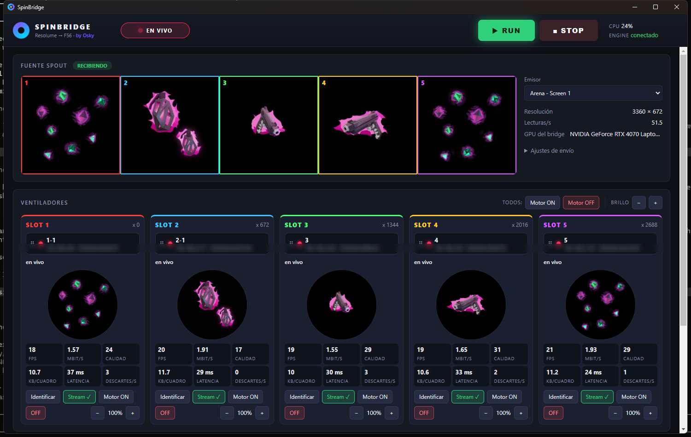

# SpinBridge — by Osky

Envía en vivo los slices de Resolume Arena (por Spout) a varios ventiladores holográficos **SpinDisplay F56** al mismo tiempo, cada uno con su propio contenido.

> **EN:** SpinBridge streams live Resolume Arena output (via Spout) to multiple SpinDisplay F56 holographic fans over Wi-Fi, each with its own content. The official app can only project to one fan at a time; SpinBridge speaks the fans' projection protocol directly (reverse-engineered for interoperability, see [docs/PROTOCOL.md](docs/PROTOCOL.md)).



**Descarga:** el instalador para Windows está en [Releases](../../releases/latest).

**Documentación:**
- [docs/PROTOCOL.md](docs/PROTOCOL.md): protocolo del F56 (descubrimiento, control, proyección) y bitácora de pruebas.
- [docs/NETWORK.md](docs/NETWORK.md): mediciones de red con 5 ventiladores y comparación de routers (resumen: con un AP enterprise ~17 fps por ventilador; con routers de consumo ~13).

> ⚠️ **Aviso.** Proyecto independiente, sin relación con el fabricante de SpinDisplay. El protocolo se reconstruyó para interoperar con equipos propios; el repositorio no incluye código del fabricante. Los ventiladores tienen **aspas que giran a alta velocidad**: el botón "Motor ON" las arranca a distancia, úsalo solo con los equipos montados y sin nadie cerca. Úsalo bajo tu propio riesgo.

## Instalación en el Media Server

1. Descarga `SpinBridge.Setup.1.1.0.exe` de [Releases](../../releases/latest) y ejecútalo (Windows mostrará un aviso de SmartScreen porque no está firmado: *Más información → Ejecutar de todas formas*). No requiere Python ni nada más.
2. **Cierra SpinDisplay** si está abierto (ocupa el puerto UDP 50105 y la sesión de los ventiladores).
3. Abre SpinBridge. Al arrancar:
   - registra su engine para usar la **GPU de alto rendimiento**; Resolume debe estar en la misma GPU (Spout solo comparte imagen dentro de una GPU). La GPU usada aparece en "GPU del bridge";
   - Windows puede pedir permiso de red para `spinbridge-engine`: **permitir en redes privadas**.

## Uso

| Acción | Cómo |
|---|---|
| Empezar / detener la proyección | **RUN** / **STOP** (o F9 / F10) |
| Asignar un ventilador a un slot | Arrastrar su tarjeta desde "Detectados" al slot. Si el slot estaba ocupado, intercambian lugares |
| Quitar de un slot | Arrastrar la tarjeta a "Detectados sin asignar" |
| Saber cuál es cuál físicamente | **Identificar**: muestra el número de slot en el ventilador por 5 s |
| Excluir un ventilador del RUN | **Stream ✓ / ✗** |
| Motor | **Motor ON** (pide confirmación) / **OFF**, por ventilador o todos |
| Brillo | − / + (50 % a 100 %), por ventilador o todos |
| Emisor Spout | Selector "Emisor" (por defecto `Arena - Screen 1`) |
| Calidad / FPS | "Ajustes de envío" |

Los ventiladores se guardan por **MAC**, así que la asignación sobrevive a cambios de IP o de router.

## Configuración de Resolume esperada

- Advanced Output, Screen 1 → **Spout**, 3360 × 672.
- Slices de 672 × 672 lado a lado (x = 0, 672, 1344, 2016, 2688), cada uno con su Layer como Input Source.
- Las posiciones de los slots en SpinBridge deben coincidir con esas x (se ven sobre la vista previa).

## Control externo (Stream Deck / Companion / scripts)

El engine escucha en `http://127.0.0.1:8765`:

```
GET /api/state
GET /api/run          GET /api/stop
GET /api/power?mac=all&on=0       GET /api/identify?mac=AA:BB:CC:DD:EE:FF
```

## Archivos

| Ruta | Contenido |
|---|---|
| `%APPDATA%\SpinBridge\config.json` | Ventiladores, slots, ajustes |
| `%APPDATA%\SpinBridge\spinbridge.log` | Registro de cada sesión (para revisar después del show) |

## Compilar

```
powershell -ExecutionPolicy Bypass -File build.ps1
```

Requiere Python 3.13 con `engine\requirements.txt` + `pyinstaller`, y Node.js 20+.
Para desarrollo: `python engine\server.py` y, en otra terminal, `cd app && npx electron .`

## Licencia

MIT © 2026 Osky (MoscoDJ)
